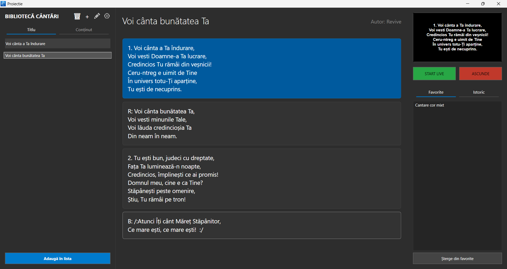

# Proiectie



Proiectie is a Windows desktop application for projecting Romanian song lyrics during live services or events. It is built with WPF on .NET 8 and uses a local SQLite database (`Cantece.db`) for storing songs, lyrics, authors, and normalized search fields.

## Features

- Search songs by title or lyrics.
- Display selected verses on one or more external monitors.
- Manage favorites and projection history.
- Add, edit, and delete songs from the local database.
- Temporarily edit a song for the live projection or save changes globally.
- Show or hide a live clock on the projection screen.
- Customize projection font, font sizes, background image, target monitors, and verse tracker color.
- Build a song database from Resurse Crestine links using the included Python scraping script.

## Requirements

- Windows
- .NET 8 SDK
- Visual Studio 2022 or another editor that supports WPF/.NET projects
- SQLite database file named `Cantece.db`
- Optional, for database generation:
  - Python 3.10+
  - `requests`
  - `beautifulsoup4`
  - `urllib3`

## Project Structure

```text
.
|-- Proiectie.sln                 # Visual Studio solution
`-- Proiectie/
    |-- Proiectie.csproj          # WPF project file
    |-- MainWindow.xaml(.cs)      # Main control window
    |-- ProjectionWindow.xaml(.cs)# Full-screen projection window
    |-- SettingsWindow.xaml(.cs)  # App settings and shortcuts
    |-- AddSongWindow.xaml(.cs)   # Add song dialog
    |-- EditSongWindow.xaml(.cs)  # Edit song dialog
    |-- Functions.cs              # Shared helpers
    |-- Song.cs                   # Song model
    |-- Properties/               # Saved application settings
    `-- ScrapingScript/           # Tools for generating the SQLite song database
```

## Getting Started

Restore dependencies:

```bash
dotnet restore Proiectie.sln
```

Build the app:

```bash
dotnet build Proiectie.sln
```

Run the app:

```bash
dotnet run --project Proiectie/Proiectie.csproj
```

The app expects `Cantece.db` to be located beside the executable, for example:

```text
Proiectie/bin/Debug/net8.0-windows/Cantece.db
```

When publishing or copying the app elsewhere, copy `Cantece.db` into the same folder as `Proiectie.exe`.

## Database Format

The application reads from a SQLite table named `Cantece` with these columns:

```sql
CREATE TABLE Cantece (
    id INTEGER PRIMARY KEY AUTOINCREMENT,
    titlu TEXT NOT NULL,
    versuri TEXT NOT NULL,
    titluNormalizat TEXT NOT NULL,
    versuriNormalizate TEXT NOT NULL,
    autor TEXT,
    url TEXT NOT NULL UNIQUE
);
```

The normalized fields are used for accent-insensitive search. Songs added from the app are inserted with a generated `manual_entry_<id>` URL.

## Generating `Cantece.db`

Install Python dependencies:

```bash
pip install requests beautifulsoup4 urllib3
```

Run the database builder with explicit paths:

```bash
python Proiectie/ScrapingScript/build_song_database.py --links Proiectie/ScrapingScript/linkuri_cantece.txt --db Cantece.db
```

Useful options:

```bash
python Proiectie/ScrapingScript/build_song_database.py --links Proiectie/ScrapingScript/linkuri_cantece.txt --db Cantece.db --limit 100
python Proiectie/ScrapingScript/build_song_database.py --links Proiectie/ScrapingScript/linkuri_cantece.txt --db Cantece.db --delay 0.3
```

After creating the database, copy it next to the executable before running the app.

## Usage

1. Open the application.
2. Use the search box to find a song by title or lyrics.
3. Select a song to load its verses.
4. Start projection with `DESCHIDE PROIECȚIA`.
5. Select or press Enter on a verse to send it live.
6. Use `- MUTE -` or Escape to clear the projected text.
7. Open settings to choose monitors, fonts, background image, tracker color, and font sizes.

If no monitor is selected in settings, the app projects to non-primary monitors by default.

## Keyboard Shortcuts

| Shortcut | Action |
| --- | --- |
| `F1` | Focus the search box |
| `F2` | Select the first song and first verse |
| `F3` | Split long verses into two parts |
| `F12` | Show or hide the projection clock |
| `+` | Increase projection text size |
| `-` | Decrease projection text size |
| `Enter` in search | Move focus to the song list |
| `Enter` in song list | Select the first verse |
| `Enter` in verse list | Send the selected verse live |
| `Escape` | Clear projected text |

## Publishing

Publish for Windows x64:

```bash
dotnet publish Proiectie/Proiectie.csproj -c Release -r win-x64 --self-contained false
```

The published output will be placed under:

```text
Proiectie/bin/Release/net8.0-windows/win-x64/publish/
```

Copy `Cantece.db` into the published folder before distributing or running the published app.

## Notes

- User settings are stored through the application settings system, not in the database.
- The projection window uses full-screen placement based on selected Windows monitor IDs.
- The scraper reads URLs from `Proiectie/ScrapingScript/linkuri_cantece.txt` and skips invalid or duplicate links.
